<p align="center">

</p>
<h3 align="center">Vaxtor License Server: centralized network licensing for Vaxtor products</h3>
<br/>
<br/>

# Vaxtor License Server - Docker Quick Start

This repository provides a production-ready, containerized license server for Vaxtor products. It runs the Sentinel LDK License Manager (`hasplmd`, from `aksusbd`) and serves network licenses to every client on your network that can reach it on port `1947`.

The image installs the License Manager manually, so it builds for both `linux/amd64` and `linux/arm64`. If you provide a Product Key, it also activates the license automatically.

**Contents**
- [Quick Start](#-quick-start) ([Build the image yourself](#-build-the-image-yourself))
- [Admin Control Center (ACC)](#-admin-control-center-acc)
- [License Activation](#-license-activation)
- [Securing the License Server](#-securing-the-license-server)
- [Volumes & Persistence](#-volumes--persistence)
- [Connecting Clients](#-connecting-clients)
- [Docker Compose](#-docker-compose)
- [Architecture & Extensibility](#-architecture--extensibility)
- [Troubleshooting](#-troubleshooting)

---

## ⚡ Quick Start

**Requirements:** Docker, port `1947` free on the host, and either a Product Key (automatic activation) or access to the [Vaxtor licensing portal](https://licensing.vaxtor.com) (manual activation).

The image is published on Docker Hub: **[vaxtor/vaxtor-licserver](https://hub.docker.com/r/vaxtor/vaxtor-licserver)** (`linux/amd64` and `linux/arm64`).

| Tag | Description |
|---|---|
| `latest` | Latest published version. |
| `10.13.1` | Same image, tagged with the Sentinel LDK Run-time (`aksusbd`) version it includes. Use it to pin the version. |

### 1. Pull the image
```bash
docker pull vaxtor/vaxtor-licserver:latest
```

### 2. Run the license server
```bash
docker run -d --name vaxtor-licserver   --hostname vaxtor-licserver   --restart unless-stopped   -p 1947:1947/tcp -p 1947:1947/udp   -v vaxtor-lic:/var/hasplm   -v vaxtor-lic-config:/etc/hasplm   -e PRODUCT_KEY=<PKID>   vaxtor/vaxtor-licserver:latest
```

Omit `-e PRODUCT_KEY=<PKID>` to activate the license manually from the Admin Control Center (see [License Activation](#-license-activation)).

Or with Docker Compose (it pulls the published image):
```bash
PRODUCT_KEY=<PKID> docker compose up -d
```

### 3. Expected output (`docker logs vaxtor-licserver`)
```
[2026-11-18 01:42:37] [INFO] === Initializing Vaxtor License Server (x86_64 Environment, aksusbd 10.13.1) ===
[2026-11-18 01:42:37] [INFO] No hasplm.ini found. Installing default configuration...
[2026-11-18 01:42:37] [INFO] Starting License Manager (hasplmd)...
[2026-11-18 01:42:37] [INFO] Waiting for License Manager to be ready on port 1947...
Using Admin LM 30.2 build 173288 64 bit, RTE 10.13
Listen on port 1947 for TCP, UDP, TCP6, UDP6
Loaded VLIB 10.13 build 173288 for vendor 97461
[2026-11-18 01:42:39] [INFO] License Manager is ready.
[2026-11-18 01:42:39] [INFO] No license installed. Activating license with provided Product Key...
[2026-11-18 01:42:39] [INFO] Extracting host fingerprint...
[2026-11-18 01:42:39] [INFO] Connecting to License Server...
[2026-11-18 01:42:39] [INFO] Requesting activation...
[2026-11-18 01:42:40] [INFO] Processing activation response...
[2026-11-18 01:42:40] [INFO] Applying license file to the License Manager...
[2026-11-18 01:42:40] [INFO] License successfully activated and attached.
[2026-11-18 01:42:40] [INFO] License server activated successfully.
[2026-11-18 01:42:40] [INFO] Vaxtor License Server is running. Admin Control Center available on port 1947.
```

> The lines without a timestamp come from the License Manager itself. On later starts the activation is skipped: `License found in /var/hasplm. Skipping activation.`

### 🔨 Build the image yourself
If you prefer not to use the image from Docker Hub, you can build it from this repository. You only need Docker and Internet access (the Sentinel LDK Run-time is downloaded from `nexus.vaxtor.com` during the build).

```bash
git clone https://github.com/Vaxtor-Technologies/vaxtor-licserver-docker.git vaxtor-licserver-docker
cd vaxtor-licserver-docker
docker build -t vaxtor-licserver:local .
```

The `local` tag makes it clear that this image was built on your machine and is not the one from Docker Hub. Use `vaxtor-licserver:local` instead of `vaxtor/vaxtor-licserver:latest` in the `docker run` command above. With Docker Compose, in [docker-compose.yml](docker-compose.yml) uncomment the `build` lines of the service **and** replace the `image:` line with `image: vaxtor-licserver:local` (otherwise your build would be tagged with the Docker Hub name). Then build and start in one step:
```bash
docker compose up -d --build
```

| Build argument | Default | Description |
|---|---|---|
| `VERSION` | `10.13.1` | Sentinel LDK Run-time (`aksusbd`) version, downloaded from `https://nexus.vaxtor.com/repository/sentinel/`. |

```bash
# Build a specific Run-time version
docker build --build-arg VERSION=10.13.1 -t vaxtor-licserver:local .

# Multi-platform image (amd64 + arm64)
docker buildx build --platform linux/amd64,linux/arm64 -t <registry>/vaxtor-licserver:latest --push .
```

---

## 🖥️ Admin Control Center (ACC)

The License Manager web console is available at **`http://<server-ip>:1947`**. From the ACC you can check the status of the licenses, see which clients are using them, install or update licenses and adjust the configuration.

The configuration pages are protected with a user and password. The defaults are:

| User | Password |
|---|---|
| `admin` | `admin` |

> **⚠️ Change the default password** right after the first start and restrict who can reach your licenses. See [Securing the License Server](#-securing-the-license-server).

---

## 🔑 License Activation

The License Manager only serves licenses that have been activated for **this** server. There are two ways to activate them.

### 1. Automatic activation (Product Key)
Pass your Product Key with `PRODUCT_KEY=<PKID>`. On start, if no Vaxtor license is installed yet, the container:
1. Extracts the server fingerprint (C2V) from the local License Manager.
2. Logs in to `https://licensing.vaxtor.com` with the Product Key and requests the activation.
3. Applies the returned license (V2C) to the License Manager.

Requirements and behavior:
* The container needs outbound HTTPS access to `licensing.vaxtor.com` during the activation.
* The activation runs **only once**. When a license is already installed in `/var/hasplm`, it is skipped, so keeping `PRODUCT_KEY` in your configuration does not consume new activations.
* If the activation fails (wrong Product Key, no Internet access, no activations left...), the error is logged and the **License Manager keeps running**, so you can fix the cause and restart the container, or activate manually from the ACC.

### 2. Manual activation (offline)
Use this method when the server has no Internet access, or when you prefer to activate from the licensing portal. You will need a computer with a browser that can reach both the ACC and the portal.

**1. Download the server fingerprint.** Open the ACC (`http://<server-ip>:1947`). The first time you will see a row **"Reserved for New SL Key"** with a **Fingerprint** button on its right side. Click it to download the fingerprint (a `.c2v` file).

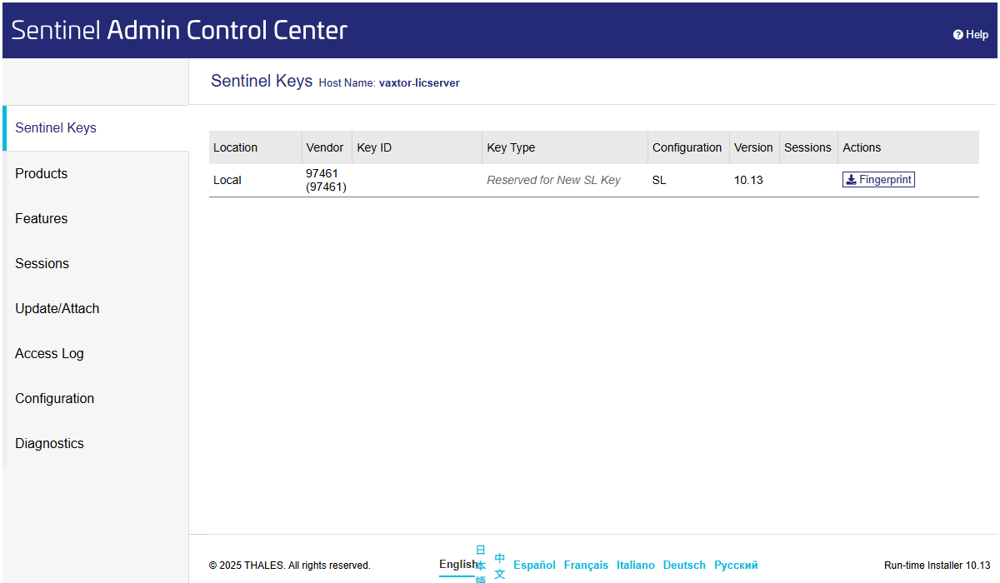

**2. Log in to the licensing portal.** Go to [https://licensing.vaxtor.com](https://licensing.vaxtor.com) and log in with your Product Key.

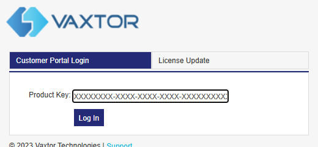

**3. Start the offline activation.** The portal shows your Product Key, its activations and the products it includes. Click **Offline Activation**.

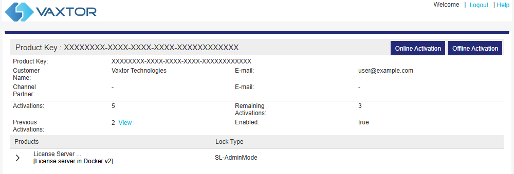

**4. Upload the fingerprint.** Click **...**, select the `.c2v` file from step 1, optionally write a comment (for example, the name of the server) and click **Generate**.

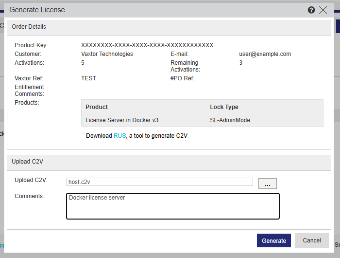

**5. Download the license.** The portal lists the new license under *Activation Details*, with the **Key ID** of your server. Click **V2C File** to download it.

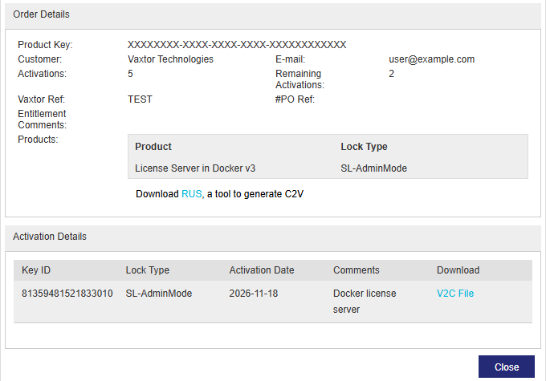

**6. Apply the license.** Back in the ACC, select **Update/Attach** in the menu, click **Select File...**, choose the `.v2c` file and click **Apply File**.

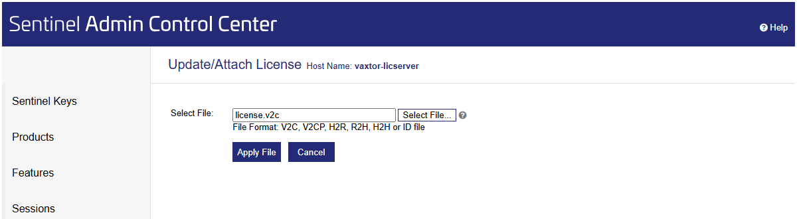

**7. Check the result.** A message confirms that the update was applied and shows the Key ID of the license.

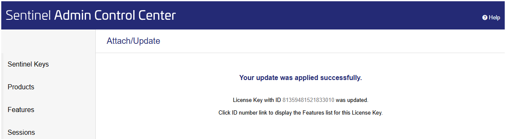

The main screen of the ACC now lists your license with its **Key ID**. This Key ID is unique and identifies your license.

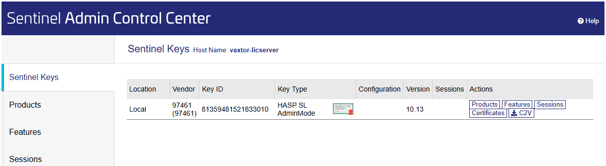

---

## 🔒 Securing the License Server

By default, any machine that can reach port 1947 can consume your licenses, and the ACC is protected only by the default password. Before putting the server in production, do the two steps below.

### 1. Restrict who can consume the licenses
Open the ACC and go to *Configuration* → **Access from Remote Clients** (`http://<server-ip>:1947/_int_/config_from.html`).

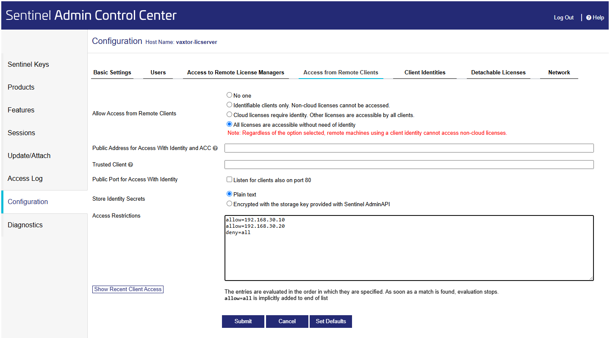

1. In **Allow Access from Remote Clients**, select **All licenses are accessible without need of identity**.
2. In **Access Restrictions**, write one `allow=<client_ip>` line for every client that may use the licenses, and **make sure the last line is `deny=all`**:
   ```
   allow=192.168.30.10
   allow=192.168.30.20
   deny=all
   ```
3. Click **Submit**. The change applies immediately, without restarting the container.

How the restrictions work:
* The entries are evaluated **in order**, and the evaluation stops at the first match.
* `allow=all` is implicitly added at the end of the list. **Without a final `deny=all`, every client that is not listed can still use your licenses.**
* Each `allow` entry can be a single IP (`allow=192.168.30.10`), a network in CIDR notation (`allow=192.168.30.0/24`) or a wildcard on whole octets (`allow=192.168.30.*`). Other forms, such as IP ranges with a dash (`10.0.0.1-10.0.0.9`) or partial wildcards (`192.168.30.1*`), are not recognized and the clients would be denied.
* The button **Show Recent Client Access** lists the addresses of the clients that have recently contacted the server. Use it to find the exact address you have to allow.
* The restrictions are saved in the `[ACCESS]` section of `/etc/hasplm/hasplm.ini` (volume `vaxtor-lic-config`), so they survive container re-creation.

> **⚠️ Warning:** The server evaluates the source address of each request **as it reaches the container**. Depending on how Docker is networked (for example, Docker Desktop, or a published port with NAT), clients may appear with the address of the Docker gateway instead of their own. Use *Show Recent Client Access* to check which address the server sees, and allow that one. If you need to filter by the real client address, run the container on the host network (`--network host`, Linux only).

### 2. Protect and change the ACC password
Go to *Configuration* → **Basic Settings** (`http://<server-ip>:1947/_int_/config.html`).

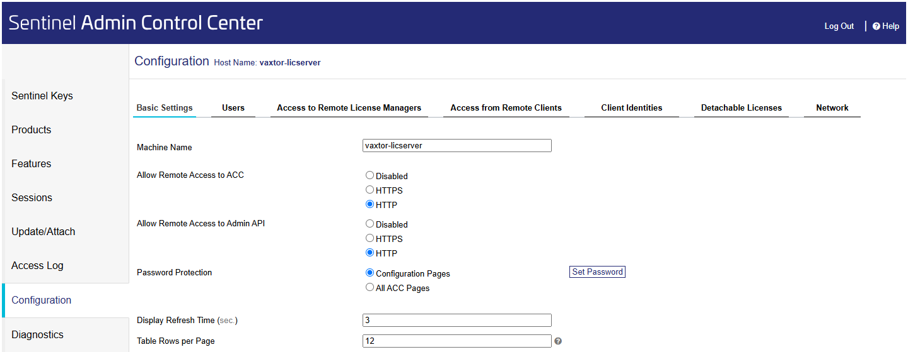

* **Password Protection** selects which pages require the password:
  * **Configuration Pages** (default): only the configuration pages ask for the password.
  * **All ACC Pages**: every page of the ACC requires the password. This is the recommended option for a server reachable from the network.
* Click **Set Password** to change the password of the `admin` user. Type the current password (`admin` by default), the new password and its confirmation, and click **Submit**.

  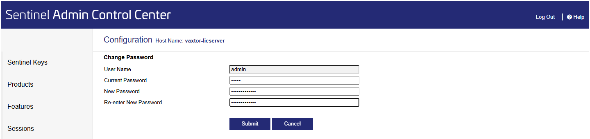

  The new password must be at least 8 characters long, and must contain an uppercase letter, a lowercase letter and a number or a special character.
* After the change, the ACC takes you to the login page. Sign in again with the new password.

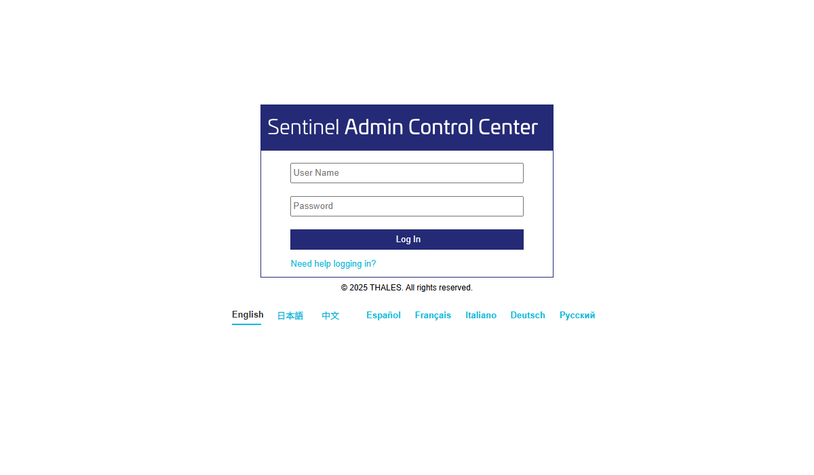

The password is stored (hashed) in `/etc/hasplm/hasplm.ini`, so it is kept as long as the `/etc/hasplm` volume is kept. Keep a copy of your password in a safe place.

---

## 💾 Volumes & Persistence

| Container path | Suggested volume | Content |
|---|---|---|
| `/var/hasplm` | `vaxtor-lic` | **Installed licenses** and the Sentinel secure storage. |
| `/etc/hasplm` | `vaxtor-lic-config` | License Manager configuration (`hasplm.ini`): admin password, access restrictions, detach settings... |

> **⚠️ Crucial:** You MUST mount a persistent volume on `/var/hasplm`. **Without it, the license is stored inside the container itself and is lost as soon as the container is destroyed.** Re-creating the server would then require a new activation.

* On the first start, if `/etc/hasplm` does not contain a `hasplm.ini`, the default configuration of the image is installed. After that, the file is never overwritten, so your changes are kept across image upgrades.
* The ACC web pages and help come from the image, so upgrading the image also upgrades the ACC, even with an existing configuration volume.
* Licenses are locked to the machine where they were activated. Keep the volumes on the same Docker host; do not copy them to another machine.

### Backup and restore
Stop the server first, so the License Manager is not writing to the volume:
```bash
docker stop vaxtor-licserver

# Backup
docker run --rm -v vaxtor-lic:/data -v "$PWD":/backup debian:trixie-slim \
  tar czf /backup/vaxtor-lic.tgz -C /data .

# Restore (on the same host)
docker run --rm -v vaxtor-lic:/data -v "$PWD":/backup debian:trixie-slim \
  tar xzf /backup/vaxtor-lic.tgz -C /data

docker start vaxtor-licserver
```

---

## 🔌 Connecting Clients

> **⚠️ Alert:** Clients that consume the licenses must have **direct network connectivity** to the license server on port `1947` (TCP, and UDP for discovery).

The settings below are configured **on the clients** (the Vaxtor products that consume the licenses), **not on the license server** described in this repository. They tell each client where to find the license server. Clients find it either by its address or by UDP broadcast on the local network.

* **Vaxtor products distributed as Docker images:** pass the server address with the environment variable `LICENSE_SERVER_ADDR=<server-ip>` (`-e LICENSE_SERVER_ADDR=<server-ip>` in `docker run`, or under `environment:` in Docker Compose). Available repositories:
  * [vaxtorgenesis-docker](https://github.com/Vaxtor-Technologies/vaxtorgenesis-docker)
  * [vaxtorlpr-docker](https://github.com/Vaxtor-Technologies/vaxtorlpr-docker)
  * [vaxlprx-docker](https://github.com/Vaxtor-Technologies/vaxlprx-docker)
  * [vaxtorlpr-engine-docker](https://github.com/Vaxtor-Technologies/vaxtorlpr-engine-docker)
* **Native installations (not Docker):** set the server address in the client `hasplm.ini` (`[REMOTE]` section, `serveraddr = <server-ip>`) or in the client ACC (*Configuration* → *Access to Remote License Managers*).

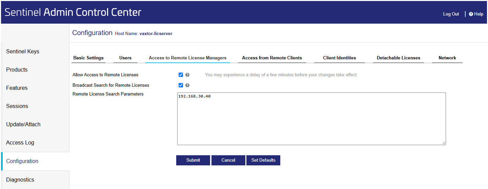

> **💡 Note:** **Broadcast Search for Remote Licenses** is enabled by default, so the client also looks for license servers on its local network. Uncheck it if you want the client to connect **only** to the license servers listed in **Remote License Search Parameters** (in `hasplm.ini` this is `broadcastsearch = 0` in the `[REMOTE]` section).

> **💡 Note:** With the default bridge network, UDP broadcasts from clients do not reach the container, so **clients must point to the server address explicitly**. If you need automatic discovery on the LAN, run the container with the host network (`--network host`, or `network_mode: host` in Compose, Linux only) instead of publishing the ports.

---

## 🐳 Docker Compose

The included [docker-compose.yml](docker-compose.yml) defines a single service, `vaxtor-licserver`, which uses the published image `vaxtor/vaxtor-licserver:latest`, with the ports, the fixed hostname, the restart policy and both named volumes:

| Use case | Command |
|---|---|
| Manual activation from the ACC | `docker compose up -d` |
| Automatic activation with a Product Key | `PRODUCT_KEY=<PKID> docker compose up -d` |
| Follow the logs | `docker compose logs -f` |
| Build the image from this repository instead of pulling it (uncomment `build` in the file and set `image: vaxtor-licserver:local`) | `docker compose up -d --build` |

`PRODUCT_KEY` can also be stored in a `.env` file next to `docker-compose.yml`.

---

## 🏗️ Architecture & Extensibility

### Image
The `Dockerfile` builds a single, lightweight image based on `debian:trixie-slim`:
1. Installs the runtime tools: `curl`, `ca-certificates`, `libxml2-utils` (`xmllint`) and `tini`.
2. Downloads `aksusbd` from `nexus.vaxtor.com` and installs, for the target architecture, the License Manager (`hasplmd`), the Vaxtor vendor library (`haspvlib_<arch>_97461.so`) and the ACC templates and help.
3. Adds the default `hasplm.ini` and the container scripts.

The Run-time version is selected with the `VERSION` build argument (see [Build the image yourself](#-build-the-image-yourself)).

### Container scripts
* **`entrypoint.sh`:** Runs under `tini`. It prepares `/etc/hasplm` and `/var/hasplm` and starts `hasplmd` in the foreground. Once the License Manager answers on port 1947, it runs the activation if needed, then stays attached to `hasplmd`, forwarding stop signals so `docker stop` shuts it down cleanly.
* **`activate.sh`:** Product Key activation. It gets the fingerprint from the License Manager (`/download/my.fp?97461`), talks to the Vaxtor EMS, and applies the license through the License Manager (`/_int_/checkin_file.html`, the same as *Update/Attach* in the ACC).
* **`hasplm.ini`:** Default License Manager configuration: remote access to the ACC enabled, Vaxtor EMS URL and the default admin credentials.

All scripts print timestamped logs (`[YYYY-MM-DD HH:MM:SS] [INFO|ERROR] ...`). The image also defines a `HEALTHCHECK` that verifies the License Manager answers on port 1947.

### Multi-Architecture Support
`hasplmd` and the vendor library are selected according to `TARGETARCH` (`amd64`, `arm64`), so the same Dockerfile builds the image for x86 servers and for ARM devices. See [Build the image yourself](#-build-the-image-yourself) for the `buildx` command.

---

## 🛠️ Troubleshooting

| Symptom | Cause / Solution |
|---|---|
| `port is already allocated`, or the ACC shows other licenses or does not accept the credentials | Another License Manager is already using port 1947 on the host (for example, a Windows machine with Vaxtor software installed runs the *Sentinel LDK License Manager* service). Stop that service, or use a dedicated host. |
| `Authentication with License Server failed. HTTP Code: 400` | Wrong Product Key. Check it and restart the container. |
| `Could not extract activationString` | The Product Key has no activations left or the request was rejected; the EMS response is printed in the log. Contact Vaxtor support. |
| Activation fails with network errors | The container has no HTTPS access to `licensing.vaxtor.com`. Fix the network or use the [manual activation](#2-manual-activation-offline). |
| Clients do not find the license server | Check that port 1947 TCP/UDP of the server is reachable from the client and configure the server address in the client (see [Connecting Clients](#-connecting-clients)). |
| A client cannot use the licenses after adding `deny=all` | The client address is not in the list, or the server sees a different address (for example, the Docker gateway). Check *Show Recent Client Access* in *Access from Remote Clients* and add that address. See [Securing the License Server](#-securing-the-license-server). |
| The ACC does not accept `admin` / `admin` | The password was changed, or the `/etc/hasplm` volume holds an older configuration. |
| The license disappeared after re-creating the container | No persistent volume was mounted on `/var/hasplm`. Mount it and activate again. |
